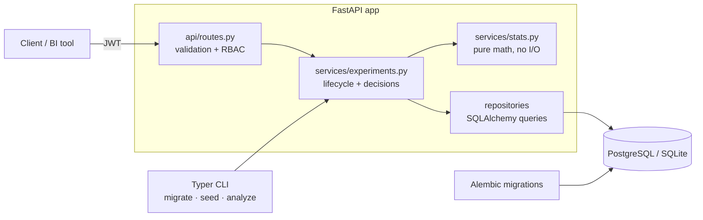

# experiment-ledger

**A/B test registry and analysis API that lets product teams check results every day without fooling themselves.**

[](https://github.com/Mbarney928/experiment-ledger/actions/workflows/ci.yml)


[](LICENSE)

## The business problem

Growth and product teams run A/B tests, then open the dashboard every morning and ship the variant the first day it shows `p < 0.05`. That habit — "peeking" — quietly turns a 5% false-positive rate into roughly **14% with just five looks** (this repo's own simulation reproduces it). Teams end up shipping changes that did nothing, and real wins get lost in the noise.

experiment-ledger is the system of record for experiments. Analysts register a test with its hypothesis and minimum detectable effect, the service works out how much traffic it needs, and every time results are recorded it applies **group-sequential boundaries** (Lan-DeMets O'Brien-Fleming alpha spending). The answer is always one of: *keep running*, *stop — treatment wins*, *stop — control wins*, *stop — no effect*, or *investigate: your traffic split is broken*. Peeking becomes safe, decisions get faster, and the false-positive rate stays at the 5% you signed up for.

**Who it helps:** product managers, growth/marketing teams and analysts at companies running more experiments than they have statisticians.
**Metric it improves:** fewer false "wins" shipped, and shorter tests when the effect is real (strong effects can stop at 40–60% of the planned sample).

## Features

- **Sample-size planning** from baseline rate, relative MDE, alpha and power — stored with each experiment as its plan
- **Peeking-safe sequential analysis**: boundaries computed by numerical integration for whatever look schedule actually happened, not a fixed calendar
- **Sample-ratio-mismatch (SRM) guard**: a chi-square check that blocks any verdict when the 50/50 split is off (a classic sign of broken assignment or logging)
- **Effect sizes, not just p-values**: absolute and relative lift, Wald CI on the difference, Wilson CIs per arm
- **Experiment lifecycle**: draft → running → stopped, with cumulative snapshots that can't go backwards
- **Role-based access**: `viewer` reads, `analyst` creates and records, `admin` manages users
- **Offline CLI** for analyzing a JSON file of looks without a database
- OpenAPI docs at `/docs`, structured JSON logs with request IDs, one-command Docker stack

## Architecture



**Key decisions and trade-offs**

- **Layered, with the math isolated.** `stats.py` has no imports from the web or DB layers, so every formula is unit-tested against reference values and a Monte Carlo simulation. `analyze_looks` is a pure function the CLI reuses.
- **Snapshots are cumulative, and each one is a look.** That matches how teams actually check dashboards and gives the sequential test the exact information fractions it needs. Recording a snapshot that decreases any count is rejected.
- **Alpha spending, not fixed boundaries.** Lan-DeMets spending lets the number and timing of looks be unplanned, which is the reality. The cost is a small increase in the final critical value (≈1.98–2.06 vs 1.96).
- **Two arms, binary metrics.** Deliberately narrow for v1; continuous metrics and multi-arm tests are on the roadmap.
- **Role comes from the database, not the token**, so demoting a user takes effect immediately instead of when their token expires.
- **In-process rate limiter** on login. Correct for one instance; a Redis-backed limiter is needed for horizontal scaling (roadmap).

## Tech stack

| Choice | Why |
|---|---|
| **FastAPI + Pydantic v2** | Typed request validation and free OpenAPI docs |
| **SQLAlchemy 2.0 + Alembic** | Typed ORM, parameterized queries only, versioned migrations; runs on SQLite locally and Postgres in Docker |
| **SciPy / NumPy** | Battle-tested distributions and root-finding for the boundary solver |
| **PyJWT + bcrypt** | Small, well-audited primitives instead of a heavyweight auth framework |
| **structlog** | JSON logs with request IDs for production log pipelines |
| **Typer + Rich** | Admin CLI with readable tables |
| **uv** | Fast, lockfile-based dependency management used identically in CI and Docker |

## Quick start

**With Docker (Postgres):**

```bash
cp .env.example .env
# Replace the two placeholders with real random values:
sed -i.bak "s/^JWT_SECRET=.*/JWT_SECRET=$(openssl rand -hex 32)/; s/^POSTGRES_PASSWORD=.*/POSTGRES_PASSWORD=$(openssl rand -hex 16)/" .env && rm .env.bak
docker compose up --build
docker compose exec api experiment-ledger seed   # prints demo logins once, to your terminal
```

**Local dev (SQLite):**

```bash
uv sync
cp .env.example .env
sed -i.bak "s/^JWT_SECRET=.*/JWT_SECRET=$(openssl rand -hex 32)/" .env && rm .env.bak
uv run experiment-ledger migrate
uv run experiment-ledger seed
uv run uvicorn --factory experiment_ledger.main:app_factory --reload
```

Open http://127.0.0.1:8000/docs. The app refuses to start if `JWT_SECRET` is missing, shorter than 32 characters, or still the placeholder.

## Usage

```bash
# Log in (demo passwords are random and printed by `seed`)
TOKEN=$(curl -s -X POST localhost:8000/auth/token \
  --data-urlencode username=analyst@example.com --data-urlencode "password=$PW" | jq -r .access_token)

# Plan
curl -s -X POST localhost:8000/planning/sample-size -H "Authorization: Bearer $TOKEN" \
  -H 'content-type: application/json' -d '{"baseline_rate": 0.10, "mde_relative": 0.10}'
# {"sample_per_arm":14751,"total_sample":29502}

# Register, start, record a look, analyze
curl -s -X POST localhost:8000/experiments -H "Authorization: Bearer $TOKEN" -H 'content-type: application/json' \
  -d '{"key":"checkout-cta","name":"Checkout CTA wording","hypothesis":"Clearer copy lifts checkout.","metric_name":"checkout_conversion","baseline_rate":0.10,"mde_relative":0.10}'
curl -s -X POST localhost:8000/experiments/checkout-cta/start -H "Authorization: Bearer $TOKEN"
curl -s -X POST localhost:8000/experiments/checkout-cta/snapshots -H "Authorization: Bearer $TOKEN" -H 'content-type: application/json' \
  -d '{"control_exposures":3000,"control_conversions":300,"treatment_exposures":3000,"treatment_conversions":350}'
curl -s localhost:8000/experiments/checkout-cta/analysis -H "Authorization: Bearer $TOKEN" | jq '{decision, summary, fixed_horizon_p_value}'
```

```json
{
  "decision": "continue",
  "summary": "20% of planned sample collected; no boundary crossed. Keep running — the naive p-value is not valid yet.",
  "fixed_horizon_p_value": 0.0378
}
```

That's the point of the tool: the naive p-value says "ship it", the sequential test says "too early".

| Method | Path | Role |
|---|---|---|
| POST | `/auth/token` | — (rate limited) |
| GET | `/auth/me` | any |
| POST | `/users` | admin |
| POST | `/planning/sample-size` | any |
| GET / POST | `/experiments` | any / analyst |
| GET | `/experiments/{key}` | any |
| POST | `/experiments/{key}/start` · `/stop` · `/snapshots` | analyst |
| GET | `/experiments/{key}/analysis` | any |
| GET | `/health` | — |

**Offline CLI:**

```bash
uv run experiment-ledger analyze looks.json --planned-per-arm 14751
```

## Testing & quality

```bash
uv run ruff check . && uv run ruff format --check . && uv run mypy && uv run pytest --cov
```

- **55 tests**, **98% line coverage** (CI fails under 90%)
- Stats verified against textbook values, an exact bivariate-normal calculation, and a 200,000-run simulation showing the sequential test holds the false-positive rate at 5.0% while naive peeking reaches ~14%
- Security tests: protected routes require auth, role checks, tampered/expired/`alg=none` tokens rejected, identical errors for wrong password vs unknown user, login rate limiting, validation errors never echo submitted values, startup fails without a real secret
- Strict mypy, Ruff (including the `flake8-bandit` rules), and a CLI smoke test that migrates, seeds, serves and health-checks

## Security

- **No secrets in the repo, ever.** Config comes only from environment variables; there are no fallback secrets, and the placeholder in `.env.example` is rejected at startup. Tests generate throwaway secrets at runtime.
- **Secret scanning** with gitleaks on every commit (pre-commit) and across the full git history in CI.
- **Dependency audit** with `pip-audit` in CI against the locked dependency set; Dependabot for Python, GitHub Actions and Docker.
- **Hardened CI**: read-only default permissions, actions pinned to commit SHAs, no repository secrets used, `persist-credentials: false`.
- **App hardening**: bcrypt password hashing, short-lived JWTs with required claims, rate-limited login, CORS limited to configured origins, security headers (CSP, `X-Frame-Options`, `nosniff`), no stack traces or input values in error responses.
- **Container**: multi-stage build, non-root user, read-only filesystem, `no-new-privileges`, ports bound to `127.0.0.1`.
- **Synthetic data only**: demo users use `example.com` addresses with random passwords printed once to your terminal; experiments are fictional.

See [SECURITY.md](SECURITY.md) to report a vulnerability.

## Roadmap

1. Continuous metrics (revenue per user) with Welch's t-test and CUPED variance reduction
2. Multi-arm tests with Holm-Bonferroni correction
3. Redis-backed rate limiting and caching of boundary computations for horizontal scaling
4. Webhook / Slack notification when an experiment crosses a boundary or trips the SRM guard
5. Event ingestion endpoint so snapshots are computed from raw exposure/conversion events

## License

Released under the [MIT License](LICENSE).
